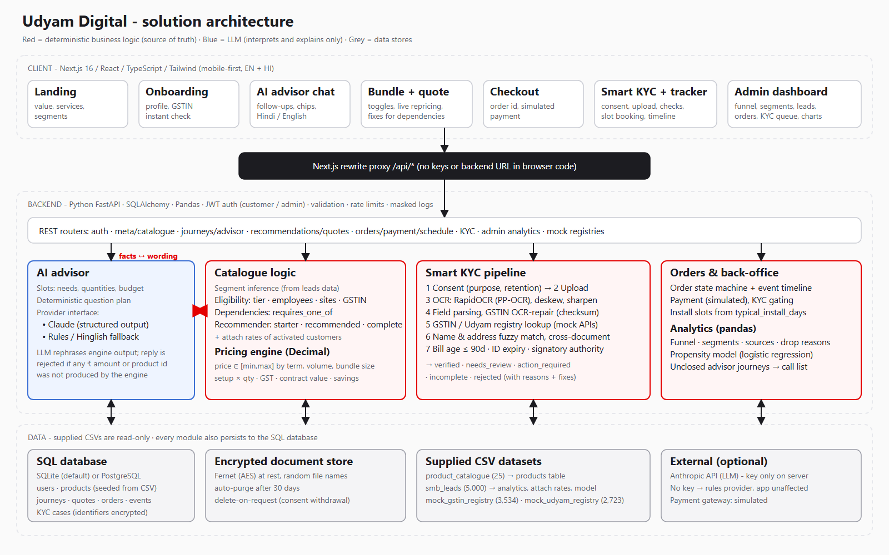

# Architecture



(`architecture.svg` is the editable source.)

## Stack and why
| Layer | Choice | Reason |
|---|---|---|
| Frontend | Next.js 16 (App Router) + React 19 + TypeScript + Tailwind 4 | Mobile-first, typed API contracts; pages are client components talking to same-origin `/api/*` |
| Proxy | `next.config.ts` rewrite `/api/*` -> `BACKEND_URL` | The browser never sees the backend address or any secret; no CORS in production |
| Backend | Python FastAPI, Pydantic v2, SQLAlchemy 2 | Validation at the edge, typed schemas, easy to test with `TestClient` |
| Data | SQLite default, PostgreSQL via `DATABASE_URL` | Zero-setup demo, production path is a URL change (JSON columns keep the schema portable) |
| Data processing | Pandas | Leads analytics, attach rates, registry lookups, propensity features |
| OCR | RapidOCR = PaddleOCR PP-OCR models on ONNX Runtime | PaddlePaddle has no wheels for current Pythons; same models, `pip install` only. OpenCV for deskew/sharpen |
| AI | Provider interface; Anthropic (structured outputs) + offline rules provider | App never depends on a key |
| Auth | bcrypt + JWT (HS256), roles `customer`/`admin` | Owner-scoped orders; admin-only back-office |
| ML | scikit-learn logistic regression | Simple, explainable propensity score (stretch goal) |

## Deterministic vs LLM boundary
```
customer text ──► Provider.extract() ──► structured needs {wants, quantities, budget...}   (LLM or rules)
                                              │
                         validated + merged by merge_needs()   (unknown tags/invalid numbers dropped)
                                              ▼
 profile + needs ──► recommender / eligibility / pricing ──► tiers, items, reasons, totals   (pure Python, CSV-driven)
                                              ▼
                  template reply (EN/HI) ──► Provider.phrase() ──► reply_is_grounded()? ──► send
                                                              └── no: send the template unchanged
```
`reply_is_grounded` extracts every `₹` amount and `Pxx` id from the LLM text and rejects the reply if any is absent from the engine's facts. The LLM therefore cannot invent a price or a product. Free-form questions after a recommendation (`provider.answer`) pass through the same guard. Without a key (or if the API errors/times out) the template is used and the chat keeps working.

## Data model (SQLAlchemy, `backend/app/models.py`)
`users` · `products` (seeded from CSV) · `journeys` (profile JSON, needs JSON, selection JSON, stage; guest-accessible by 128-bit id, bound to a user at checkout) · `advisor_messages` · `quotes` (immutable snapshot of lines + totals) · `orders` (+ `order_events` timeline) · `kyc_cases` (consent JSON, **encrypted** declared identifiers, result JSON) · `kyc_documents` (path to **encrypted** file, sha256, **encrypted** extracted fields, `purge_after`).

Relationships: user 1-n orders; journey 1-n quotes; quote 1-1 order (idempotent); order 1-1 kyc_case 1-n kyc_documents; order 1-n events.

## Pricing engine (`pricing.py`, `data/pricing_rules.json`)
The catalogue gives a range `[price_min, price_max]` per product. Position inside the range:
`position = min(1, term_bonus + volume_bonus + bundle_bonus)`; `unit_price = round(max - position x (max - min))`
- term: 24 months 0.40, 12 months 0.20 · volume: qty >= 5 0.15, >= 10 0.25 · bundle: >= 3 products 0.15, >= 5 products 0.25
- setup = catalogue setup fee x quantity (verified against all 368 historical bundles)
- GST at `GST_RATE_PERCENT` (default 18) on monthly and setup; contract value = monthly total x term + setup total
- Contract term: one per bundle, must be >= the longest `min_contract_months`; offered options `{required, 12, 24}`.
These bonus values and the GST rate are **assumptions** (the pack specifies neither); they are in config/JSON, not code, and the quote shows what was applied to each line.

## Recommendation logic (`recommender.py`)
1. Segment from business type (maps 1:1 in the leads data), overridden to multi-site when sites >= 3.
2. **Core**: one connectivity product chosen by people-per-site, segment, fibre availability (`P04` 5G fallback), first *eligible* option wins; business SIMs (`P07` or `P08` for multi-site/manufacturers).
3. **Asked**: products for needs the customer named. Present in every tier (Starter keeps them).
4. **Inferred**: failover when downtime hurts; SD-WAN + failover for >= 3 sites.
5. **Customers like you**: products whose attach rate among activated customers in the segment is >= 80% (essential), >= 40% (popular), >= 25% (extra). Computed from `smb_leads.csv` at runtime.
6. Dependencies auto-completed (`_ensure_dependencies`); ineligible products are listed with the reason and what would unlock them.
7. Three tiers (starter / recommended / complete), each priced; default = largest of starter/recommended that fits the stated budget, else starter flagged `over_budget`.

## Smart KYC pipeline (`services/kyc/`)
`ocr.py` (decode, blur score, deskew from text-line angles, optional sharpen, crop re-OCR) -> `parsers.py` (document-type detection by labels/title, label->value extraction by geometry, watermark filtering, labels hidden by the watermark recovered by position, hard-wrapped addresses re-joined, GSTIN recovered from a crop and repaired using the checksum) -> `validators.py` -> `registry.py` (mock GSTIN/Udyam APIs) -> `matching.py` -> `pipeline.py`.

Checks include: correct document type · readability · GSTIN structure + checksum + registry presence + **Active** status · certificate vs registry (legal name incl. proprietor/business parts, trade name, address) · Udyam number format/registry or lookup by name+city+state · enterprise name/city · ID expiry · signatory authority (proprietor on the GST record, or Owner/Partner/Director; otherwise authorisation letter) · utility bill age <= 90 days (not future-dated) · cross-document name consistency · GST-vs-bill address (+ pincode) · GST/Udyam state · missing required documents.

Each check yields `pass | fail | warn | info` with a plain explanation; issues carry severity `reject | fix | review` and an *action*. Case status: `rejected` (identity cannot be established) > `incomplete` (only missing documents) > `action_required` (fixable) > `needs_review` (human) > `verified`. Admins resolve `needs_review` in the KYC queue.

## Order lifecycle (`orders.py`)
`placed` -> (payment paid + KYC verified/approved) `kyc_verified` -> customer books a slot -> `install_scheduled` -> admin `installing` -> `activated` (or `cancelled`). Install visit slots start at `today + max(typical_install_days) - 1`, Sundays skipped; expected activation = visit + 1 day. The tracker derives six customer-facing steps and the single next action from the fields, so the UI cannot show a state the backend does not hold.

## Security
JWT + bcrypt; owner-scoped queries (404 for other users' orders); admin guard; Pydantic validation everywhere (422 with readable messages); upload checks (magic bytes, 8 MB, PNG/JPG, decode errors handled); per-IP rate limits on auth/upload/registry; secrets only via env (`.env.example`); Fernet encryption of files and identifiers; masked identifiers in API responses/UI; logs carry ids and hashes prefix only; generic 500 body. See [PRIVACY.md](PRIVACY.md).

## Assumptions and substitutions (documented limitations)
| Item | What was done |
|---|---|
| PaddleOCR | RapidOCR (PP-OCR models, onnxruntime) because paddlepaddle has no wheels for current Python |
| PostgreSQL | supported by URL and compose file; not available in the build environment, so not run |
| LLM key | not available; Anthropic provider written against the documented SDK, unexercised; rules provider tested |
| Payments | simulated, with a failure toggle |
| GST rate, price position | assumptions above |
| Languages | EN + HI templates; other languages need the LLM |
| Voice / WhatsApp / DigiLocker / e-sign | not built (listed as roadmap) |
